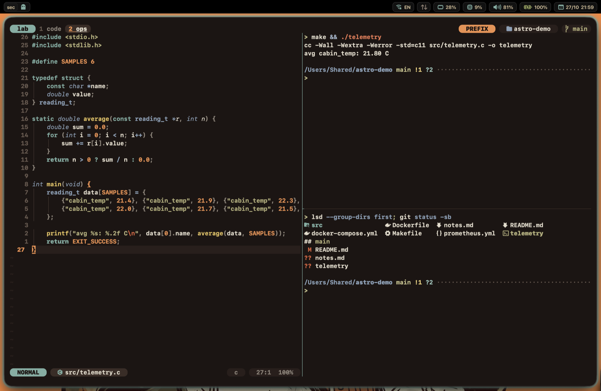
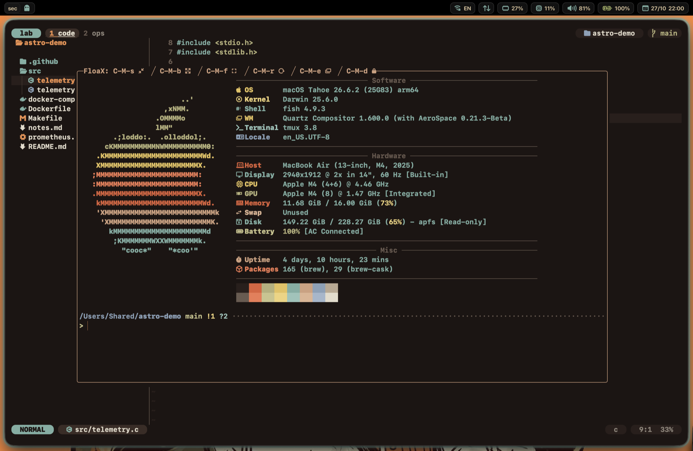
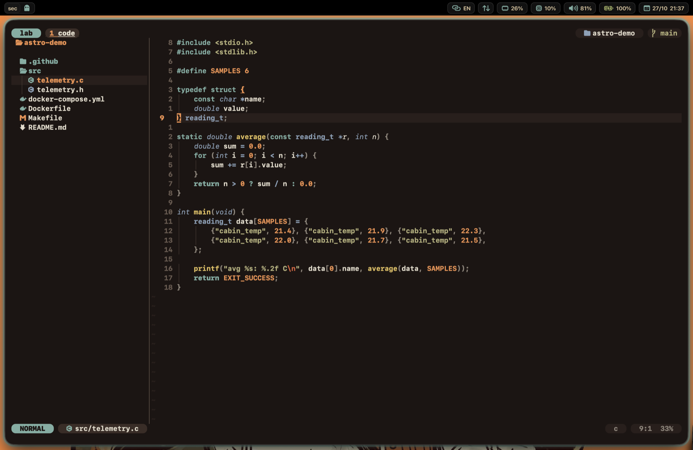
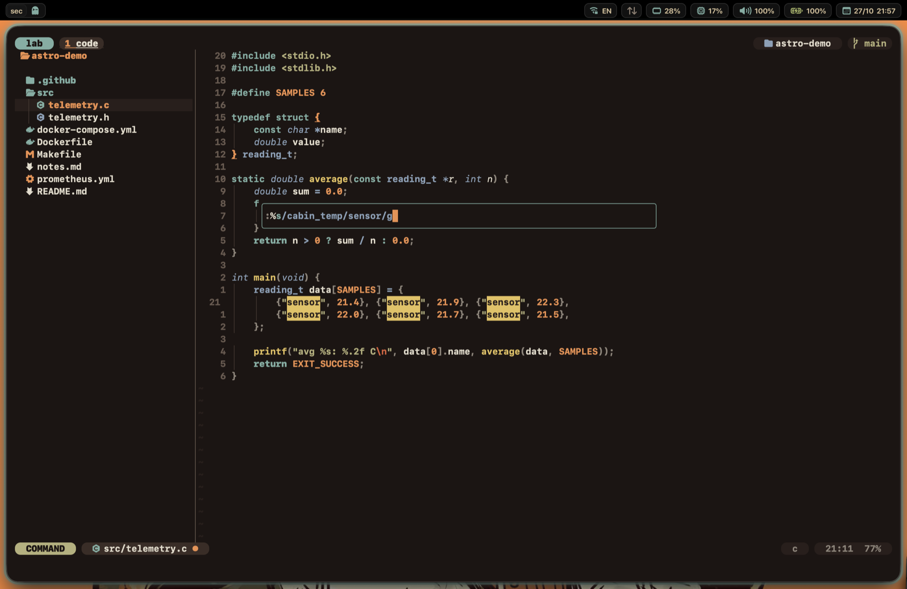
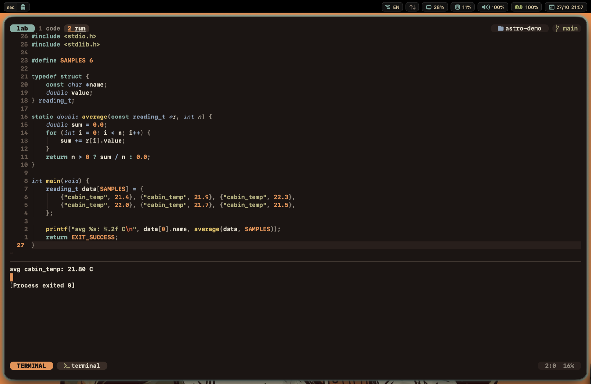
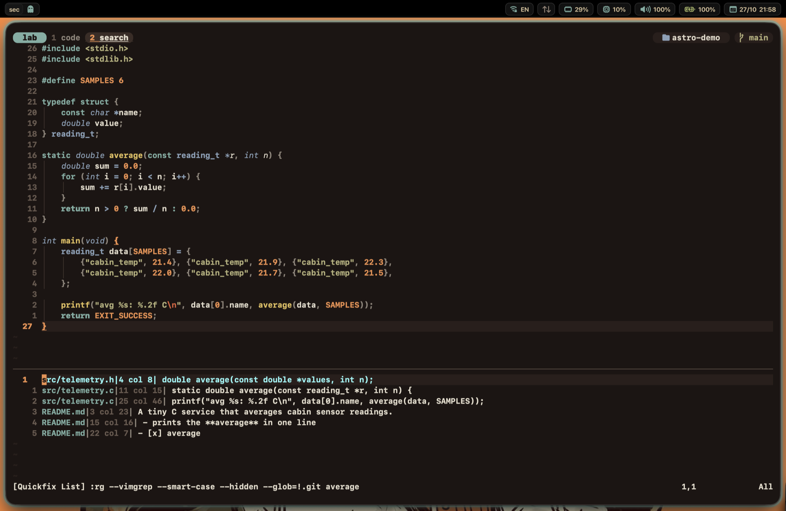
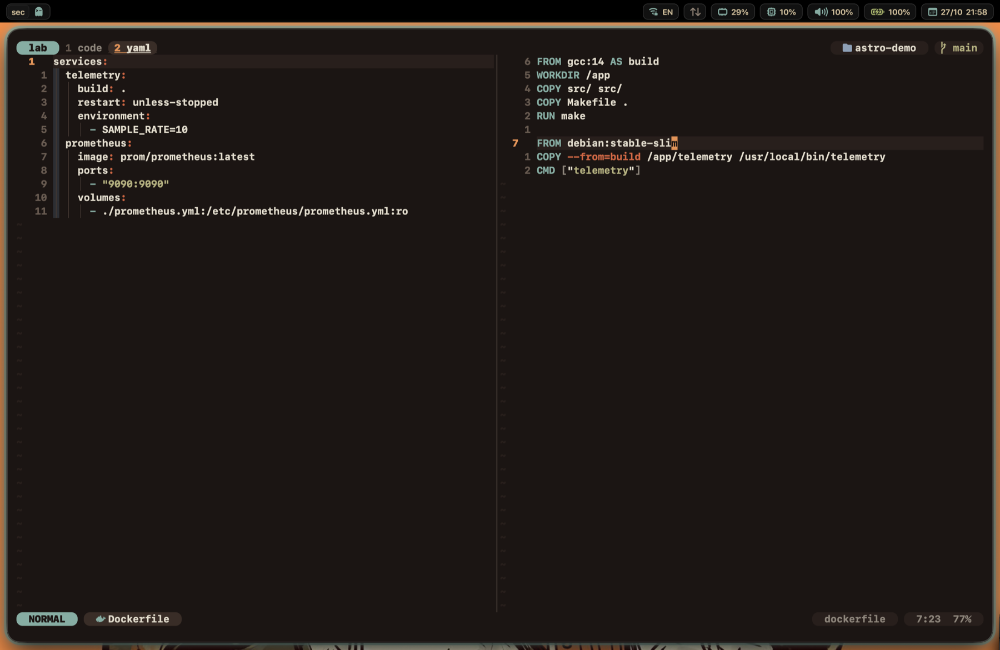
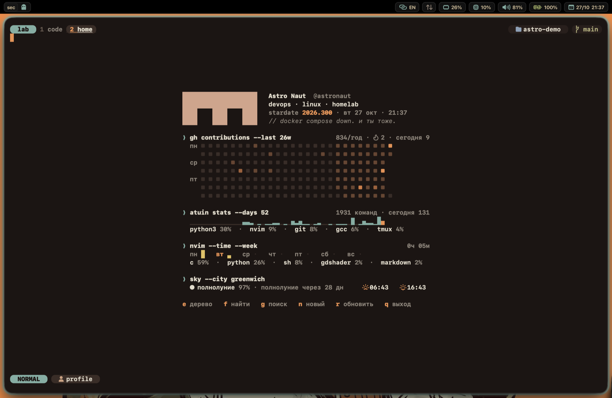
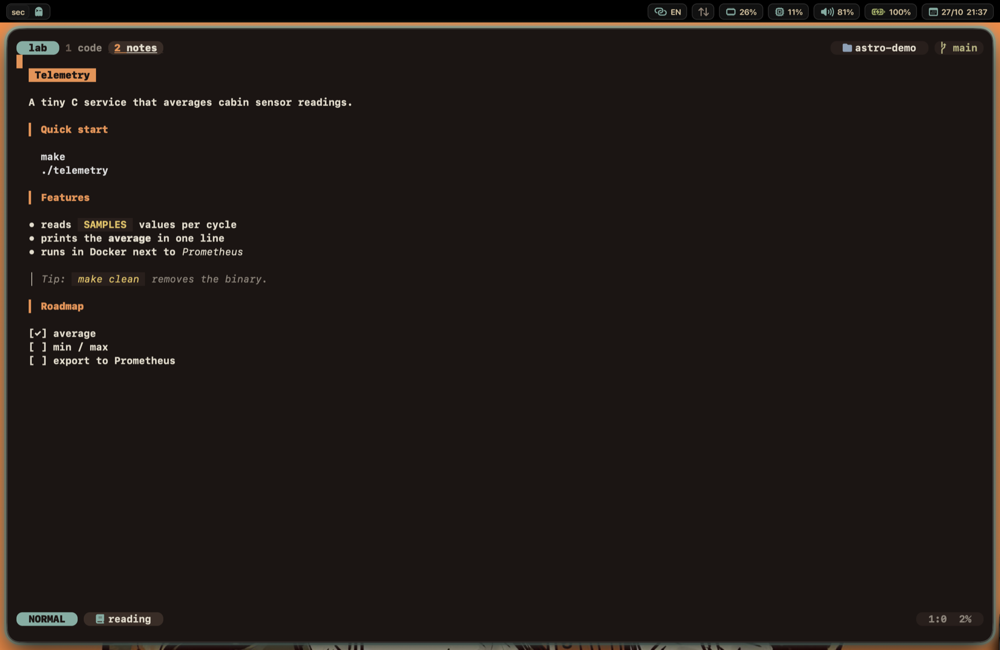

# houston

> *Houston, we have a config.*

Конфигурация macOS-окружения для работы с кодом: тайлинговые окна, верхняя
панель с виджетами, терминал, tmux и минималистичный Neovim. Всё выдержано в
одной цветовой теме — **astronaut**: тёмный фон, кремовый текст, оранжевые
акценты и голубое свечение активного окна.


## Что внутри

- **Окна** — [AeroSpace](https://github.com/nikitabobko/AeroSpace): плиточная
  раскладка, именованные рабочие пространства, управление с клавиатуры
  (`alt-h/j/k/l`, `alt-<буква>`); активное окно подсвечивает
  [JankyBorders](https://github.com/FelixKratz/JankyBorders).
- **Верхняя панель** — [SketchyBar](https://github.com/FelixKratz/SketchyBar) на Lua:
  текущий спейс и приложения в нём, сеть, раскладка, память, процессор, громкость,
  батарея, дата. По клику — карточка Apple Music (обложка, управление) и окошко
  сети (скорость, адреса, VPN). Учитывает вырез экрана MacBook.
- **Терминал** — [Ghostty](https://ghostty.org) + [fish](https://fishshell.com)
  ([Tide](https://github.com/IlanCosman/tide), [atuin](https://atuin.sh), zoxide, fzf)
  + [tmux](https://github.com/tmux/tmux) со своей темой: плашки с режимом, папкой и
  git-веткой, плавающее окно.
- **Редактор** — [Neovim](https://neovim.io) без плагинов и LSP: дерево проекта,
  поиск, запуск кода, отдельные настройки под Python, C, Markdown, YAML,
  Dockerfile и другие форматы, стартовый экран-профиль, режим чтения Markdown.
- **Клавиатура и указатель** — [Karabiner-Elements](https://karabiner-elements.pqrs.org)
  (Caps → Ctrl, стрелки на `Fn+HJKL`) и тема указателя Bibata через
  [MaCursor](https://github.com/writronic/MaCursor).
- **Инструменты** — git + delta, lazygit, yazi, btop, fastfetch, glow, Colima
  (Docker без Docker Desktop).
- **Установка одной командой** — [`Brewfile`](Brewfile) и [`install.sh`](install.sh)
  поднимают всё на чистой системе.

## Скриншоты

### tmux — панели и плавающее окно

Активная панель обведена цветной рамкой. Сверху: сессия, окна, режим (оранжевая
плашка `PREFIX`, пока нажат префикс), папка и git-ветка.



`prefix b` открывает плавающий терминал поверх остального (на кадре — `fastfetch`).



Подробнее — [`tmux/`](tmux/).

### Neovim

Дерево проекта (`Space e`) с иконками по типам файлов и строка состояния в стиле tmux:



Строка команд открывается отдельным окошком по центру (`:` и `/`); подстановка
подсвечивается во время набора:



`Space r` сохраняет и запускает файл (Python, C, bash, Dockerfile…), вывод идёт снизу:



`Space g` — поиск по проекту через ripgrep, результаты в списке:



YAML и Dockerfile рядом, с линиями уровней отступа:



Стартовый экран — мини-профиль: активность GitHub, статистика команд из atuin,
время в редакторе за неделю, фаза Луны и время восхода и заката:



Режим чтения Markdown (`Space p`), рендерит [glow](https://github.com/charmbracelet/glow)
в цветах темы:



Подробнее — [`nvim/`](nvim/).

## Установка

Требования: macOS на Apple Silicon (пути вида `/opt/homebrew` прописаны в
конфигах), доступ в интернет, учётная запись администратора. Разрабатывалось и
проверялось на macOS 26.

```sh
# если ~/.config уже существует — сначала переместить его
mv ~/.config ~/.config.bak

git clone https://github.com/Uzalov-Gamid/houston.git ~/.config
~/.config/install.sh
```

Скрипт идемпотентен — его можно запускать повторно. Он последовательно:

1. ставит Command Line Tools и Homebrew;
2. устанавливает всё из `Brewfile`: приложения, утилиты и шрифты (App Store — через `mas`);
3. ставит npm-пакеты и Python-библиотеки ([`python/requirements.txt`](python/requirements.txt));
4. собирает Lua-модуль SbarLua для SketchyBar и небольшую утилиту переключения раскладки;
5. спрашивает имя и почту для git (сохраняются в `git/identity`);
6. делает fish оболочкой по умолчанию и ставит плагины fish и tmux;
7. запускает SketchyBar и AeroSpace.

После установки:

- выдать AeroSpace и Karabiner права «Универсальный доступ», когда macOS попросит;
- открыть `cursor/BibataModernIceSmall.cursor` в MaCursor и нажать **Apply**;
- по желанию создать `nvim/lua/local_profile.lua` по образцу
  `local_profile.example.lua` — имя, ник и город для стартового экрана Neovim.

Правила «приложение → рабочее пространство» в [`aerospace/aerospace.toml`](aerospace/aerospace.toml)
рассчитаны на конкретный набор программ; под свой набор их нужно поправить
(идентификатор приложения показывает `aerospace list-apps`). Ширина выреза экрана
для панели задаётся в [`sketchybar/settings.lua`](sketchybar/settings.lua) (`ui.notch_width`).

## Как устроен репозиторий

Репозиторий — это сама папка `~/.config`: программы читают конфиги прямо из неё,
ни симлинков, ни копирования нет.

- Изменения применяются сразу после перезапуска соответствующей программы;
  как именно — написано в README папки.
- В git попадает только то, что явно разрешено в [`.gitignore`](.gitignore)
  (белый список): токены, ключи, кэши и состояние приложений остаются локальными.
  Чтобы добавить новый конфиг, нужна строка `!/имя-папки/`.
- Локальные файлы, которых в репозитории нет: `git/identity` (имя и почта для
  коммитов, шаблон — `identity.example`) и `nvim/lua/local_profile.lua`
  (профиль для стартового экрана).

```
вход в систему
 ├─ AeroSpace ─────────── окна и рабочие пространства
 │    ├─ запускает borders ─ свечение вокруг активного окна
 │    └─ шлёт события ─────► SketchyBar — верхняя панель
 ├─ Karabiner-Elements ── переназначение клавиш
 └─ MaCursor ──────────── тема указателя

терминал
 Ghostty ─► fish (Tide, atuin, zoxide) ─► tmux ─► Neovim
```

## Тема astronaut

Единая палитра для Ghostty, tmux, Neovim, glow и панели:

| Роль | Цвет |
|---|---|
| Фон | `#1c1513` |
| Текст | `#e3dccb` |
| Акцент, «активное» | `#7daea3` (голубой) |
| Второй акцент | `#ef8f4c` (оранжевый) |
| Жёлтый / олива / сталь | `#e5c15a` / `#b5b07a` / `#8aa1b8` |
| Красный / песочный | `#e0603a` / `#d0a07e` |

Голубой отмечает всё активное: рамку окна, текущий спейс, режим NORMAL, сессию
tmux. Оранжевый используется точечно — числа, константы, предупреждения.

## Папки

У каждой папки есть свой README: клавиши, команды, как менять.

| Папка | Содержимое |
|---|---|
| [`aerospace/`](aerospace/) | Менеджер окон: рабочие пространства, горячие клавиши, правила для приложений |
| [`borders/`](borders/) | Свечение вокруг активного окна |
| [`sketchybar/`](sketchybar/) | Верхняя панель: виджеты, попапы, общий стиль «капсул» |
| [`karabiner/`](karabiner/) | Переназначение клавиш |
| [`cursor/`](cursor/) | Тема указателя мыши и скрипт изменения её размера |
| [`ghostty/`](ghostty/) | Терминал: тема, шрифт, выпадающий терминал |
| [`fish/`](fish/) | Оболочка: сокращения, функции, `rm` в Корзину |
| [`tmux/`](tmux/) | tmux: тема, клавиши, плагины, шпаргалка |
| [`nvim/`](nvim/) | Neovim: настройки, дерево проекта, стартовый экран, шпаргалка |
| [`git/`](git/) | Настройки git, delta, алиасы |
| [`atuin/`](atuin/) | История команд с поиском (`Ctrl-R`) |
| [`zsh/`](zsh/) | Запасная оболочка и промпт Starship ([`starship.toml`](starship.toml)) |
| [`btop/`](btop/) | Монитор процессов |
| [`fastfetch/`](fastfetch/) | Сводка о системе |
| [`glow/`](glow/) | Стиль для чтения Markdown в терминале |
| [`colima/`](colima/) | Docker без Docker Desktop |
| [`python/`](python/) | Список Python-библиотек |

В корне: [`Brewfile`](Brewfile) — все программы и шрифты,
[`install.sh`](install.sh) — установка на новую систему,
[`.editorconfig`](.editorconfig) — отступы по папкам репозитория.

## Обслуживание

| Команда | Что делает |
|---|---|
| `brew bundle --file=~/.config/Brewfile` | Доустановить недостающее |
| `brew bundle check --file=~/.config/Brewfile --verbose` | Показать, чего не хватает |
| `brew bundle cleanup --file=~/.config/Brewfile` | Показать установленное, но не описанное в `Brewfile` (`--force` — удалить) |
| `brew update && brew upgrade` | Обновить всё |

Новая программа, которую нужно сохранить в окружении, добавляется строкой в `Brewfile`.
