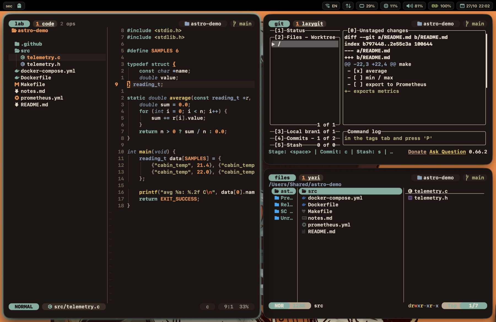

# AeroSpace — окна и спейсы

Конфиг: [`aerospace.toml`](aerospace.toml). Открыть: `asconf` (fish).

AeroSpace сам раскладывает окна по экрану (как i3 на Linux) и даёт
**именованные спейсы** вместо рабочих столов macOS. Запускается при входе в
систему (Login Item) и сам запускает [borders](../borders/) и обновляет
[SketchyBar](../sketchybar/).



## Спейсы

Все спейсы постоянные — существуют, даже когда пустые.

| Спейс | Перейти | Перенести окно туда | Кто попадает автоматически |
|---|---|---|---|
| `main` | `alt-m` | `alt-shift-m` | VS Code |
| `sec` | `alt-s` | `alt-shift-s` | Spotify |
| `brwse` | `alt-o` | `alt-shift-o` | Safari, Helium, Zen |
| `note` | `alt-n` | `alt-shift-n` | Obsidian, ZenNotes |
| `ai` | `alt-i` | `alt-shift-i` | ChatGPT, Gemini |
| `chat` | `alt-t` | `alt-shift-t` | Telegram, Messages, Mail, Rocket.Chat |
| `vpn` | `alt-v` | `alt-shift-v` | Happ, Incy |
| `Cal&Rem` | `alt-r` | `alt-shift-r` | — (кладёшь окна сам) |
| `term` | `alt-g` | `alt-shift-g` | Ghostty |

Finder и QuickTime всегда **плавающие** (не тайлятся).

## Окна

| Клавиши | Действие |
|---|---|
| `alt-h/j/k/l` | Фокус на окно слева / снизу / сверху / справа |
| `alt-shift-h/j/k/l` | Передвинуть окно |
| `alt-minus` / `alt-equal` | Уменьшить / увеличить окно |
| `alt-slash` | Раскладка «плитки» (окна рядом) |
| `alt-comma` | Раскладка «аккордеон» (окна стопкой, видны края) — **по умолчанию** |
| `alt-tab` | Вернуться на предыдущий спейс |
| `alt-shift-tab` | Перенести спейс на другой монитор |

## Сервисный режим — `alt-shift-;`

В баре под именем спейса появится `[S]`. Дальше одна клавиша:

| Клавиша | Действие |
|---|---|
| `esc` | **Перечитать конфиг** и выйти из режима |
| `r` | Сбросить раскладку спейса |
| `f` | Окно: плавающее ↔ тайловое |
| `backspace` | Закрыть все окна спейса, кроме текущего |
| `alt-shift-h/j/k/l` | Объединить окно с соседним в группу |

## Как поменять

- **Приложение всегда открывать в своём спейсе** — блок в конце конфига:
  ```toml
  [[on-window-detected]]
  if.app-id = 'com.apple.Notes'
  run = ['move-node-to-workspace note']
  ```
  Bundle ID приложения: `aerospace list-apps`.
- **Новый спейс** — добавить имя в `persistent-workspaces` и пару строк
  `alt-<клавиша> = 'workspace имя'` / `alt-shift-<клавиша> = 'move-node-to-workspace имя'`.
  Показать его в баре — сам подхватит.
- Имя со спецсимволом (как `Cal&Rem`) в командах пишется в кавычках:
  `'workspace "Cal&Rem"'` — `&` служебный символ AeroSpace.
- Применить изменения: `alt-shift-;` → `esc`.

## Полезные команды

```sh
aerospace list-workspaces --all      # все спейсы
aerospace list-windows --all         # все окна: id, приложение, заголовок
aerospace list-apps                  # bundle ID запущенных приложений
aerospace reload-config              # перечитать конфиг из терминала
```

## Английская раскладка в Ghostty

Когда фокус переходит на окно Ghostty, раскладка сама переключается на
английскую (ABC) — команды не начнутся с «ыщ». Внутри Ghostty можно спокойно
переключиться на русский — до следующей смены фокуса он останется.

- [`ghostty-en.sh`](ghostty-en.sh) — вызывается из `on-focus-changed`: если в фокусе
  Ghostty, включает ABC.
- [`input-source.swift`](input-source.swift) — маленькая программа для смены
  раскладки, собранная в `~/.local/bin/input-source` (это делает `install.sh`):
  `input-source` — показать текущую, `input-source com.apple.keylayout.Russian` — включить.
- Для другого приложения — заменить bundle ID в `ghostty-en.sh`
  (`aerospace list-apps`); отключить — убрать строку с `ghostty-en.sh` из `on-focus-changed`.

## Связь с баром

При смене спейса, фокуса или режима AeroSpace шлёт в SketchyBar события
`aerospace_refresh` / `aerospace_mode_change` (строки `exec-on-workspace-change`,
`on-focus-changed`, `on-mode-changed` в начале конфига) — так бар знает, что
перерисовать.
